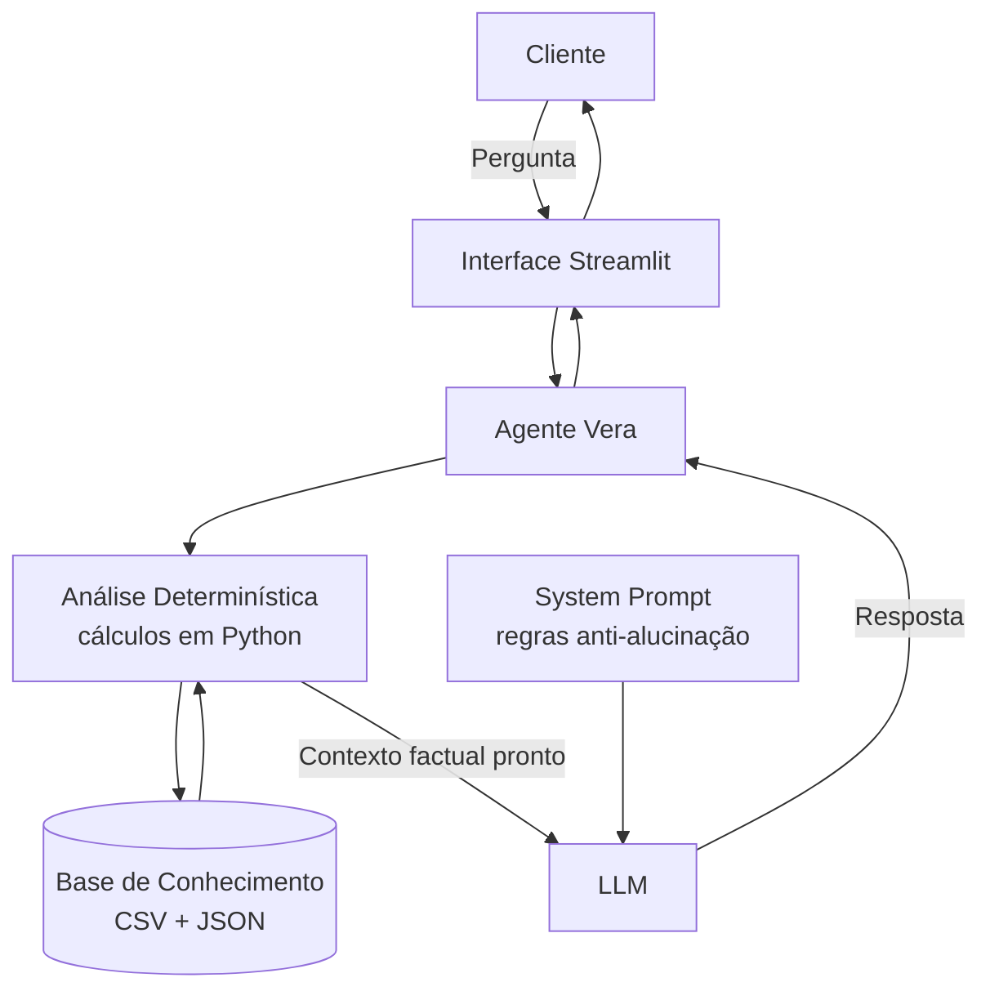

# Vera — Assistente Financeira Inteligente

> Projeto final do **Bootcamp Bradesco — GenAI, Dados & Cyber (DIO)**.
> Um agente financeiro com IA Generativa que **só responde com base em dados
> reais** — o nome "Vera" vem de *verdade*.

A Vera conversa em linguagem natural, analisa as finanças do cliente e
recomenda investimentos de forma **proativa e consultiva**, com uma
arquitetura pensada para **eliminar alucinações**: toda a matemática
financeira é feita em Python antes de a IA falar.

---

## O que a Vera faz

- **Analisa gastos** — calcula receitas, despesas, saldo e gastos por
  categoria a partir das transações.
- **Acompanha metas** — mostra quanto falta para cada objetivo, em quanto
  tempo e qual aporte mensal é necessário.
- **Recomenda investimentos** — sugere apenas produtos compatíveis com o
  perfil e a tolerância a risco do cliente.
- **É proativa** — aponta oportunidades que o cliente nem perguntou (ex.:
  "sobrou dinheiro, que tal investir na sua reserva?").
- **Não inventa** — se a informação não está nos dados, ela avisa. Se o
  assunto não é finanças, recusa educadamente.

---

## Como funciona (anti-alucinação)

O truque central: **a IA nunca faz contas**. Uma camada determinística em
Python calcula todos os números e entrega prontos para o modelo, que só
explica e recomenda.



Resultado: **precisão de 100% nos valores**, respostas auditáveis e
coerência garantida com o perfil do cliente.

---

## Estrutura do Repositório

```
vera-assistente-financeiro/
├── README.md
├── data/                          # Base de conhecimento (dados mockados)
│   ├── transacoes.csv
│   ├── historico_atendimento.csv
│   ├── perfil_investidor.json
│   └── produtos_financeiros.json
├── docs/                          # Documentação dos 6 passos do desafio
│   ├── 01-documentacao-agente.md  # Caso de uso, persona, arquitetura, segurança
│   ├── 02-base-conhecimento.md    # Estratégia de dados
│   ├── 03-prompts.md              # System prompt e engenharia de prompts
│   ├── 04-metricas.md             # Avaliação e testes
│   └── 05-pitch.md                # Roteiro do pitch
└── src/                           # Código da aplicação
    ├── app.py                     # Interface do chat (Streamlit)
    ├── agente.py                  # Lógica do agente + análise determinística
    ├── config.py                  # Configuração (lê do .env)
    ├── requirements.txt
    └── .env.example
```

---

## Como Rodar

### 1. Instalar as dependências
```bash
cd src
pip install -r requirements.txt
```

### 2. Configurar a chave de API
Copie o arquivo de exemplo e preencha com suas credenciais:
```bash
cp .env.example .env
```

A Vera funciona com **qualquer provedor compatível com a API da OpenAI**.
Escolha um no `.env`:

| Provedor | Custo | Observação |
|----------|-------|------------|
| **OpenAI** | pago | `gpt-4o-mini` é barato e rápido |
| **Groq** | grátis | camada gratuita generosa (`llama-3.3-70b-versatile`) |
| **Ollama** | grátis | roda 100% local, sem chave |

### 3. Rodar a aplicação
```bash
streamlit run app.py
```

> Prefere testar sem interface gráfica? Rode `python agente.py` para
> conversar direto pelo terminal.

---

## Testando

Perguntas para experimentar (e o que esperar):

| Pergunta | Comportamento esperado |
|----------|------------------------|
| "Quanto gastei com alimentação?" | R$ 570,00, com detalhamento |
| "Onde estou gastando mais?" | Moradia, R$ 1.380,00 (55%) |
| "Qual investimento você recomenda?" | Tesouro Selic / produtos de risco baixo |
| "Qual a previsão do tempo?" | Recusa educada (fora do escopo) |
| "Quanto rende o produto XYZ?" | Admite não ter esse dado |

Detalhes e resultados em [`docs/04-metricas.md`](./docs/04-metricas.md).

---

## Cliente de exemplo

Os dados são **fictícios**, de um cliente chamado **João Silva** (32 anos,
analista de sistemas, perfil moderado, montando a reserva de emergência).
Nenhum dado real é utilizado.

---

## Tecnologias

- **Python** — lógica do agente e análise determinística
- **Streamlit** — interface do chat
- **API OpenAI-compatível** — LLM (OpenAI, Groq ou Ollama)
