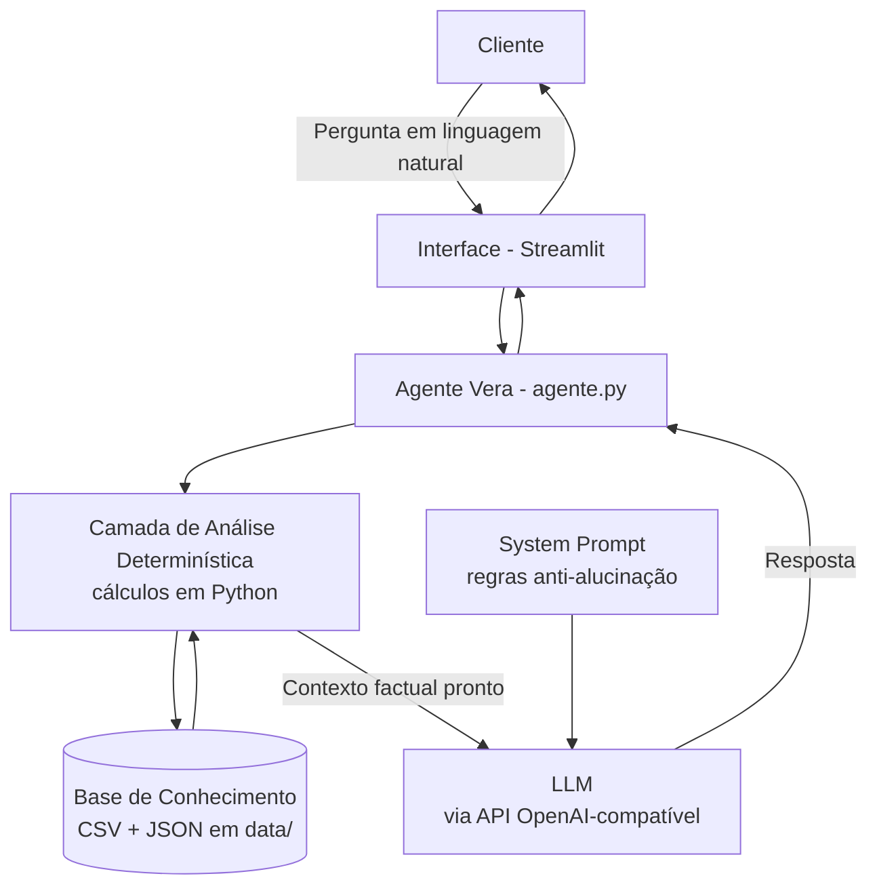

# Documentação do Agente

## Caso de Uso

### Problema
A maioria das pessoas tem acesso ao próprio extrato bancário, mas não
consegue transformar aquela lista de transações em **decisões**. Perguntas
simples ficam sem resposta no dia a dia:

- "Para onde está indo o meu dinheiro?"
- "Eu consigo poupar para o meu objetivo?"
- "Onde eu deveria investir a minha sobra, sem correr risco que eu não quero?"

Os canais tradicionais são reativos: o cliente precisa saber exatamente o
que perguntar, ir atrás da informação e ainda fazer as contas sozinho. Isso
gera paralisia e faz muita gente deixar dinheiro parado ou tomar decisões
mal informadas.

### Solução
A **Vera** é uma assistente financeira que conversa em linguagem natural e
atua de forma **proativa e consultiva**. Ela:

1. **Lê os dados reais do cliente** (transações, perfil, metas e produtos
   disponíveis) e calcula tudo automaticamente — quanto entrou, quanto saiu,
   para onde foi cada real e o quanto falta para cada meta.
2. **Responde perguntas** sobre gastos, saldo e metas com números exatos.
3. **Antecipa oportunidades**: percebe que sobrou dinheiro no mês e sugere
   onde alocá-lo, sempre respeitando o perfil de risco declarado.
4. **Recomenda produtos** compatíveis com o perfil, explicando o porquê em
   linguagem simples.

O diferencial é a **confiabilidade**: a Vera nunca inventa números. Toda a
matemática é feita em Python antes de a IA falar; o modelo de linguagem só
explica e recomenda em cima de dados prontos e verificados.

### Público-Alvo
Pessoas físicas em início ou meio da jornada financeira — quem tem uma renda
estável, quer organizar os gastos e começar a investir, mas se sente
inseguro com o "financês". No dataset de exemplo, o cliente é o **João
Silva**, 32 anos, analista de sistemas, perfil moderado, montando a reserva
de emergência.

---

## Persona e Tom de Voz

### Nome do Agente
**Vera** — o nome vem de *verdade*. É uma promessa embutida na marca: ela só
fala o que os dados sustentam.

### Personalidade
Consultiva, acolhedora e **educativa**. A Vera não julga os gastos do
cliente; ela traduz os dados em clareza e sugere o próximo passo. É proativa:
além de responder o que foi perguntado, aponta oportunidades e riscos
relevantes que o cliente não perguntou.

### Tom de Comunicação
Informal-profissional e **acessível**. Explica termos financeiros como se
estivesse conversando com alguém que está começando. Frases curtas, no máximo
um emoji por mensagem, sem jargão desnecessário.

### Exemplos de Linguagem
- **Saudação:** "Olá, João! Eu sou a Vera, sua consultora financeira 💰. O que você gostaria de saber hoje?"
- **Confirmação:** "Boa pergunta! Deixa eu olhar seus dados aqui rapidinho."
- **Recomendação:** "Considerando seu objetivo e que você prefere não correr risco, faria sentido começar pelo Tesouro Selic. É uma sugestão educativa, combinado? 😊"
- **Erro/Limitação:** "Não encontrei essa informação nos seus dados. Mas posso te mostrar o resumo dos seus gastos, se ajudar."

---

## Arquitetura

### Diagrama

### Componentes

| Componente | Descrição |
|------------|-----------|
| **Interface** | Chatbot em Streamlit (`src/app.py`) com painel lateral que mostra perfil, resumo de gastos, gráfico por categoria e progresso das metas. |
| **Agente** | `src/agente.py` — orquestra tudo: carrega dados, calcula métricas, monta o contexto, mantém o histórico e chama o LLM. |
| **Camada de Análise Determinística** | Funções Python (`analisar_transacoes`, `analisar_metas`, `selecionar_produtos`) que geram **todos os números** antes de a IA responder. É o núcleo da estratégia anti-alucinação. |
| **Base de Conhecimento** | Arquivos CSV/JSON em `data/` (transações, perfil, produtos, atendimentos). |
| **LLM** | Qualquer modelo compatível com a API da OpenAI (OpenAI, Groq gratuito, Ollama local). Configurável no `.env`. |
| **System Prompt** | Regras de comportamento e restrições de segurança, com exemplos (few-shot). Fica em `agente.py` e está documentado em `docs/03-prompts.md`. |

---

## Segurança e Anti-Alucinação

### Estratégias Adotadas

- [x] **A IA nunca faz contas.** Todos os valores (saldo, gastos por categoria, quanto falta para cada meta, aporte mensal necessário) são calculados em Python e entregues prontos no contexto. O LLM apenas explica.
- [x] **Respostas ancoradas nos dados.** O system prompt determina que 100% das respostas se baseiem no bloco de contexto. Nada de valores, produtos ou taxas que não estejam na base.
- [x] **Quando não sabe, admite.** Se a informação não está nos dados, a Vera declara isso claramente e oferece uma alternativa, em vez de inventar.
- [x] **Recomendação só com base no perfil.** A Vera só sugere produtos da lista "compatíveis com o perfil". Produtos de risco acima do que o cliente aceita são filtrados automaticamente e nunca aparecem como recomendação.
- [x] **Coerência de risco reforçada em código.** Mesmo o rótulo do João sendo "moderado", como ele declara `aceita_risco: false`, o sistema restringe as sugestões a produtos de risco baixo. O comportamento declarado pesa mais que o rótulo.
- [x] **Temperatura baixa (0.3)** nas chamadas ao LLM, reduzindo variação e criatividade indevida.
- [x] **Few-shot prompting:** o system prompt traz exemplos concretos de perguntas e respostas ideais, incluindo como recusar temas fora do escopo.

### Limitações Declaradas
A Vera **NÃO**:
- faz previsões de mercado nem promete rentabilidade futura (rentabilidades citadas são as informadas na base, não garantia);
- substitui um assessor de investimentos certificado — suas sugestões são educativas;
- executa operações (não compra, vende nem transfere dinheiro);
- acessa dados de outros clientes, nem lida com senhas ou informações sensíveis;
- responde temas fora de finanças (clima, esportes, etc.).
